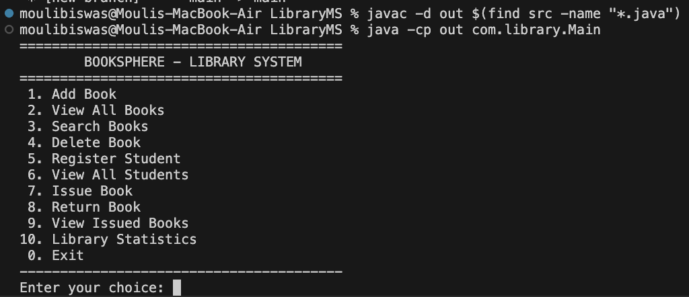
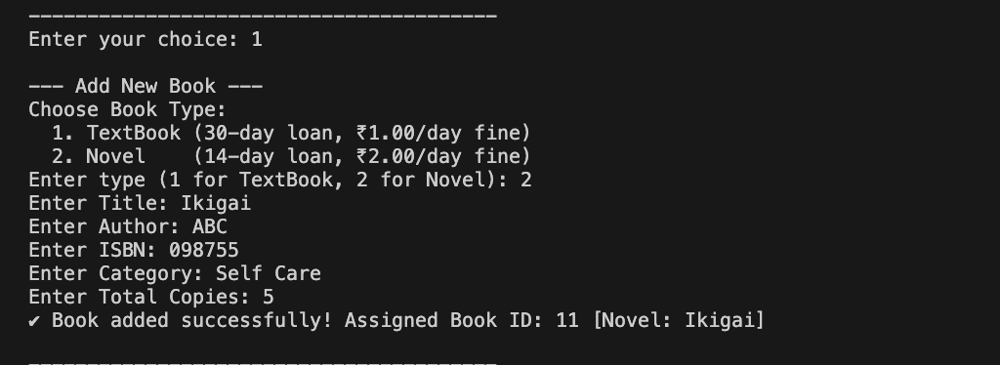
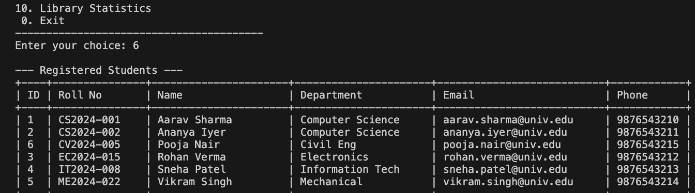
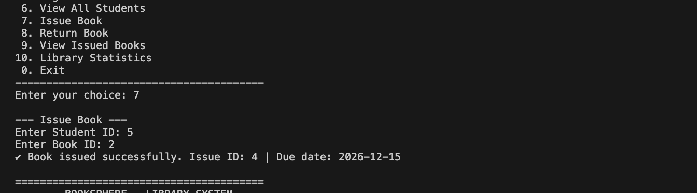
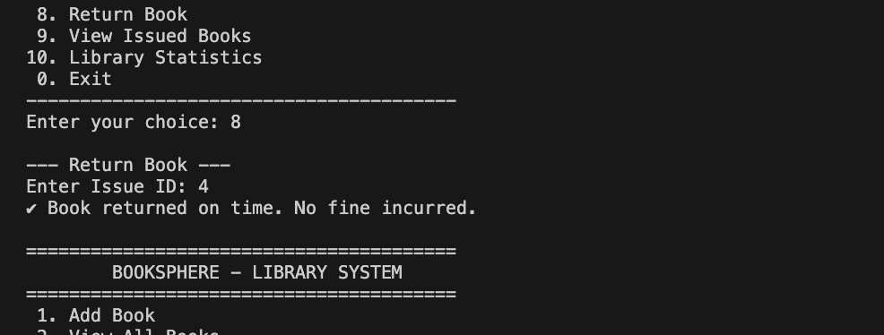
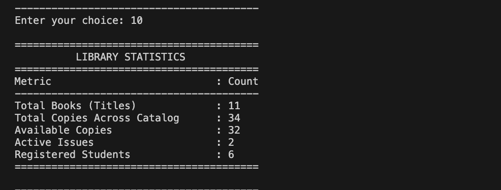

# 📚 BookSphere – Console Library Management System


A simple **menu-driven Library Management System** written in **Core Java**. It runs entirely in the terminal and uses no database, no framework and no external libraries. It is built to demonstrate **all 7 core OOP concepts** in one small, easy-to-understand project.

---

## 📑 Table of Contents

1. [Features](#-features)
2. [Screenshots](#-screenshots)
3. [Technologies Used](#-technologies-used)
4. [OOP Concepts Implemented](#-oop-concepts-implemented)
5. [Class Diagram](#-class-diagram)
6. [Project Structure](#-project-structure)
7. [How to Run](#-how-to-run)
8. [Sample Output](#-sample-output)
9. [Future Improvements](#-future-improvements)
10. [Author](#-author)

---

## ✨ Features

- **Add, view, search and delete books** (by title, author or ISBN)
- **Two book types** with different rules:

  | Type | Loan Period | Late Fine |
  |---|---|---|
  | **Textbook** | 30 days | ₹1.00 / day |
  | **Novel** | 14 days | ₹2.00 / day |

- **Register and view students** with input validation (10-digit phone, valid email, unique roll number)
- **Issue a book** – blocked if no copies are left, if the student already holds the same book, or if the student already has 3 active loans
- **Return a book** – fine is calculated automatically based on book type
- **View all issued books** and a summary of library statistics
- **Custom exceptions** for clean, readable error messages
- **Sample data** is loaded at startup so the program can be demonstrated immediately

---

## 🖼️ Screenshots


| Main Menu | Add / View Books |
|:---:|:---:|
|  |  |

| Register / View Students | Issue a Book |
|:---:|:---:|
|  |  |

| Return Book with Fine | Library Statistics |
|:---:|:---:|
|  |  |

---

## 🛠️ Technologies Used

| Category | Tool / Technology |
|---|---|
| **Language** | Core Java 17+ (works on JDK 17, 21, 25) |
| **Application Type** | Console / Command-line (menu-driven) |
| **Input** | `java.util.Scanner` |
| **Data Storage** | In-memory Java Collections (`ArrayList`, `HashMap`) |
| **Date Handling** | `java.time.LocalDate`, `ChronoUnit` |
| **Compiler & Runtime** | `javac` and `java` (JDK) |
| **IDE (any)** | VS Code / IntelliJ IDEA / Eclipse / NetBeans |
| **Version Control** | Git & GitHub |

> No database, no web server, no external JAR files and no Docker are needed.

---

## 🧩 OOP Concepts Implemented

| # | Concept | Where It's Used |
|---|---|---|
| 1 | **Classes & Objects** | `Student`, `TextBook`, `Novel`, `IssueRecord` are created as objects |
| 2 | **Encapsulation** | Private fields with getters and validating setters in `Person`, `LibraryItem`, `IssueRecord` |
| 3 | **Inheritance** | `Student extends Person`, `TextBook extends LibraryItem`, `Novel extends LibraryItem` |
| 4 | **Polymorphism** | *Overriding:* `calculateFine()` and `getLoanPeriodDays()` · *Overloading:* `search(keyword)` and `search(keyword, category)` |
| 5 | **Abstraction** | `abstract class Person`, `abstract class LibraryItem`, `interface Searchable<T>` |
| 6 | **Collections Framework** | `ArrayList<LibraryItem>`, `ArrayList<Student>`, `HashMap`, `Comparator` for sorting |
| 7 | **Exception Handling** | Custom exceptions extending `LibraryException`, plus `try-catch` in the menu loop |

### Key Code Snippets

**Inheritance & Runtime Polymorphism**
```java
abstract class LibraryItem {
    public abstract int getLoanPeriodDays();
    public abstract double calculateFine(long daysLate);
}

class TextBook extends LibraryItem {
    @Override public int getLoanPeriodDays() { return 30; }
    @Override public double calculateFine(long daysLate) { return daysLate > 0 ? daysLate * 1.0 : 0.0; }
}

class Novel extends LibraryItem {
    @Override public int getLoanPeriodDays() { return 14; }
    @Override public double calculateFine(long daysLate) { return daysLate > 0 ? daysLate * 2.0 : 0.0; }
}
```
The service simply calls `item.calculateFine(daysLate)`. Java picks the correct version at runtime, so no `if (item instanceof TextBook)` is needed.

**Compile-Time Polymorphism (Overloading)**
```java
public List<LibraryItem> search(String keyword) { ... }
public List<LibraryItem> search(String keyword, String category) { ... }
```

**Encapsulation**
```java
public void setTotalCopies(int totalCopies) throws InvalidInputException {
    if (totalCopies < 0) throw new InvalidInputException("Total copies cannot be negative.");
    this.totalCopies = totalCopies;
}
```

**Custom Exceptions:** `LibraryException` is the base class, with `BookNotFoundException`, `StudentNotFoundException`, `BookNotAvailableException`, `DuplicateEntryException` and `InvalidInputException` extending it.

---

## 📐 Class Diagram

```text
        Person (abstract)                 LibraryItem (abstract)            Searchable<T> (interface)
              ▲                             ▲              ▲                       ▲
              │                             │              │                       │
          Student                      TextBook          Novel               LibraryService
                                                                           (implements Searchable)

   IssueRecord ── links one Student with one LibraryItem

   LibraryException (base)
     ├── BookNotFoundException
     ├── StudentNotFoundException
     ├── BookNotAvailableException
     ├── DuplicateEntryException
     └── InvalidInputException
```


---

## 📁 Project Structure

```text
BookSphere-Console/
├── README.md
├── screenshots/                  # Your project screenshots
└── src/com/library/
    ├── Main.java                 # Menu-driven console interface
    ├── model/
    │   ├── Person.java           # Abstract base class
    │   ├── Student.java          # extends Person
    │   ├── LibraryItem.java      # Abstract base class
    │   ├── TextBook.java         # extends LibraryItem
    │   ├── Novel.java            # extends LibraryItem
    │   └── IssueRecord.java      # Issue / return record
    ├── service/
    │   ├── Searchable.java       # Generic interface
    │   └── LibraryService.java   # Business logic (issue, return, search, fines)
    ├── exception/
    │   ├── LibraryException.java
    │   ├── BookNotFoundException.java
    │   ├── StudentNotFoundException.java
    │   ├── BookNotAvailableException.java
    │   ├── DuplicateEntryException.java
    │   └── InvalidInputException.java
    └── util/
        └── Validator.java        # Phone / email validation
```

---

## 🚀 How to Run

**Requirement:** JDK 17 or higher. Check with:
```bash
java -version
javac -version
```

**1. Clone the repository**
```bash
git clone https://github.com/mouli-tech2025/LibraryMS.git
cd LibraryMS
```

**2. Compile**
```bash
# Linux / macOS
javac -d out $(find src -name "*.java")

# Windows (Command Prompt)
javac -d out src/com/library/*.java src/com/library/*/*.java
```

**3. Run**
```bash
# Linux / macOS
java -cp out com.library.Main

# Windows
java -cp out com.library.Main
```

The menu appears in the terminal. Type the number of an option and press **Enter**.

---

## 💻 Sample Output

```text
========================================
        BOOKSPHERE - LIBRARY SYSTEM
========================================
 1. Add Book
 2. View All Books
 3. Search Books
 4. Delete Book
 5. Register Student
 6. View All Students
 7. Issue Book
 8. Return Book
 9. View Issued Books
10. Library Statistics
 0. Exit
----------------------------------------
Enter your choice: 7
Enter Student ID: 3
Enter Book ID: 5
✔ Book issued successfully. Due date: 2026-12-15

Enter your choice: 8
Enter Issue ID: 1
✔ Book returned. Days late: 4 | Fine: ₹8.00
```

> Replace this with your own output if it differs.

---

## 🔮 Future Improvements

- Save data to a **file** (serialization / CSV) so records persist after exit
- Connect to **MySQL using JDBC**
- Add a **web or GUI interface** (JavaFX / Swing)
- Add **login** for librarian and student roles

---


- **Course:** Object-Oriented Programming (OOP) Lab – Mini Project
- **College:** *Your College Name*
- **GitHub:** [mouli-tech2025/BookSphere](https://github.com/mouli-tech2025/BookSphere)

---

*Built with Core Java and clean object-oriented design.*
